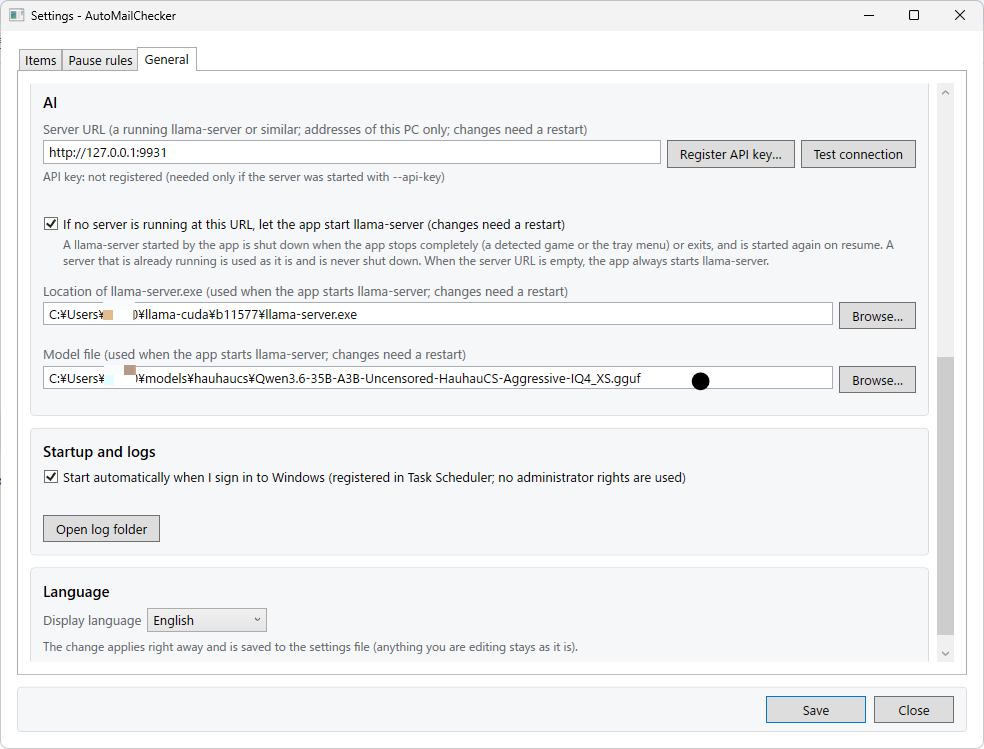

# AutoMailChecker
## What Is This
It's a software which a local AI check and arrangement your e-mail to appropriate folders.

## Why It Created
I have four e-mail addresses and I have been received them about 130 per day.
So, I sometimes overlook important e-mails.
Therefore, I created this.

## How To Use
### What You Need
|Things|Details|
|:---:|:---:|
|OS|Windows(can't move on MacOS and Linux)|
|Software|.NET 10 SDK|
|Local AI|llama.cpp(lamma-server.exe) and a GGUF-Format model|
|e-mails|Only Gmail or iCloud|

### How To Built
You can buit this on CMD
```
dotnet build AutoMailChecker/AutoMailChecker.sln -c Release
```
After built, You can startup on ``AutoMailChecker/src/AutoMailChecker.App/bin/Release/net10.0-windows/AutoMailChecker.exe``.

### How to use
#### E-mail

You have to regist your accounts.
If you regist iCloud, you need ID(the address except "@icloud.com") and an app-specific passwords. <https://support.apple.com/en-us/102654>
If you regist gmail, you need ID(the address include "@gmail.com") and app passwords. <https://support.google.com/mail/answer/185833?hl=en>

#### AI

You have to regist llama.cpp and a local AI.
If you start llama.cpp before start this app, you need regist only server URL, or else you need regist location of llama-server.exe and model file.

#### Language
Japanese or English
