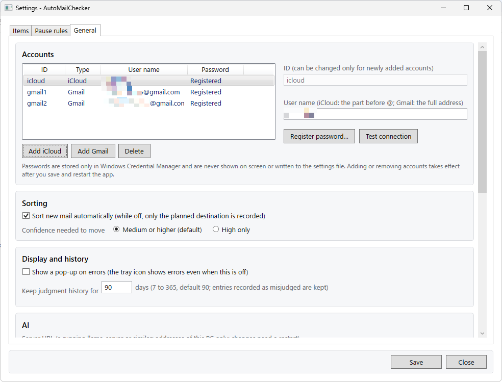

# AutoMailChecker
## What Is This
It's a Windows app that uses a local AI to check emails and sort them into right folders.

## Why I Made
I have four email addresses and I receive about 130 per day.
So, I sometimes overlook important e-mails.
Therefore, I created this.

## How To Use
### What You Need
|Things|Details|
|:---:|:---:|
|OS|Windows (doesn't run on macOS and Linux)|
|Software|.NET 10 SDK|
|Local AI|llama.cpp (llama-server.exe) and a GGUF-Format model|
|emails|Only Gmail or iCloud|

### How To Build
You can buit this on CMD
```
dotnet build AutoMailChecker/AutoMailChecker.sln -c Release
```
After building, run on ``AutoMailChecker/src/AutoMailChecker.App/bin/Release/net10.0-windows/AutoMailChecker.exe``.

### Email

You have to register your accounts.
If you register iCloud, you need ID (the address except "@icloud.com") and an app-specific passwords. <https://support.apple.com/en-us/102654> \
If you register gmail, you need ID (the address include "@gmail.com") and app passwords. <https://support.google.com/mail/answer/185833?hl=en>

### AI

You have to register llama.cpp and a local AI.
If you start llama.cpp before start this app, you need regist only server URL, or else you need register location of llama-server.exe and model file.

#### Language
Japanese or English
